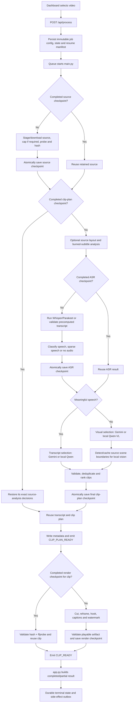

# Pipeline checkpointing: actual code flow

This document traces one video from the OpenShorts dashboard through the
current implementation. It records the real code path, the checkpoint boundary
at each step, and the restart behaviour.

The rule is intentionally simple:

- a stage is reusable only after its complete output validates and is written
  atomically;
- a crash or invalid/partial output creates no completed-stage checkpoint;
- a restart loads the furthest valid completed boundary and begins at the first
  incomplete stage;
- fine-grained local-model caches may preserve independently completed windows,
  but they never make the whole selection stage complete.

## Flow diagram

## Step-by-step code path

1. **Dashboard submission**

   - `dashboard/src/App.jsx`, `handleProcess()`, builds a JSON or multipart
     request.
   - `dashboard/src/components/MediaInput.jsx` supplies the selected local file,
     URL, or Thumbnail Studio handover.
   - No checkpoint exists yet. An interrupted browser upload must be submitted
     again because the server has not accepted a complete source.

2. **Request acceptance and durable job creation**

   - `app.py`, `process_endpoint()`, validates the request, generation controls,
     source duration/quality policy and ownership.
   - A local upload is fully written into `output/<job-id>/source.<ext>` before
     durable execution begins. A Thumbnail Studio transcript is written as
     `source_transcript.json`.
   - `_resolved_job_config()` seals `.job-config.json`, including source
     settings, model routes, render settings, checkpoint enablement and the
     precomputed transcript SHA-256 when one exists.
   - `job_state.write_job_state()` writes `.job-state.json`.
   - `_write_resume_manifest()` writes `.resume.json`.
   - Request-scoped secrets are stored separately by
     `job_state.write_resume_secrets()` when a resume keyring is configured.
   - These files are job/recovery state. They are not proof that a compute stage
     completed.

3. **Queue and child process**

   - `app.py`, `process_queue()` and `run_job_wrapper()`, claim the queued job.
   - `run_job()` starts `main.py` with the sealed child environment and streams
     internal `CLIP_PLAN_READY` and `CLIP_READY` markers.
   - A backend shutdown kills the child and leaves the resume manifest for a
     later scan.

4. **Checkpoint activation and single-writer lease**

   - `main.py` reads `PIPELINE_CHECKPOINTS_ENABLED`.
   - Effective enablement is:

     `current deployment flag AND job_config.checkpointing_enabled`.

   - `job_state.JobLease.acquire()` prevents two processes from writing the same
     project concurrently.
   - `checkpoint_store.CheckpointStore` owns all compute checkpoint validation
     and atomic persistence.
   - Default: checkpointing is **disabled**. Set
     `PIPELINE_CHECKPOINTS_ENABLED=true` before the job is accepted to enable
     it. Turning the flag on later does not retroactively enable an old job.

5. **Retained source**

   - `main.py` first calls `CheckpointStore.load_source()`.
   - A hit must match the sealed source request, SHA-256, byte size, duration
     tolerance and a successful current `ffprobe`.
   - On a miss:
     - URL input runs `download_youtube_video()`;
     - local input is hard-linked or copied into the job directory;
     - duration caps are applied before identity is finalized;
     - `_probe_source()` requires a positive duration and encoded width/height,
       with `ffprobe` covering OpenCV codec gaps;
     - `checkpoint_store.build_source_identity()` hashes and describes the
       final validated bytes.
   - `CheckpointStore.save_source()` is called only after the complete retained
     file validates.
   - Edge condition: a partial URL download left without `source.json` is not
     trusted and is downloaded again.
   - The same rule applies when the deployment checkpoint kill switch is off:
     disabling downstream checkpoint reuse never makes an unverified URL file
     safe. A valid source checkpoint may still prove the retained input bytes;
     ASR, selection and render are then recomputed because their store is
     disabled.

6. **Furthest completed analysis boundary**

   - `app.py` and `main.py` both use
     `checkpoint_store.completed_selection_boundary()`; recovery-route
     validation is centralized rather than duplicated in each process.
   - Immediately after the source is bound, `main.py` calls
     `CheckpointStore.load_current_clip_plan()`.
   - A valid `clip-plan.json` is bound to the sealed job configuration,
     retained source, ASR route/outcome and selection route.
   - When it exists, OpenShorts restores the source-analysis object embedded in
     that same plan before any optional provider call. This preserves the exact
     layout and burned-subtitle decision that the renders were keyed against.
   - A plan without that complete embedded snapshot is treated as incomplete
     and selection is recomputed once; it is never reused with newly generated
     render decisions. The snapshot explicitly records subtitle-band,
     configured layouts and per-analysis results even when they mean
     `none`/disabled.
   - A completed plan is reusable for local and Gemini routes even when the
     provider did not expose an immutable model revision. Current model weights
     are irrelevant because selection will not run again.

7. **Optional source-level layout**

   - `main.py` calls `layout_picker.resolve_config()`.
   - Default: `AUTO_LAYOUT=0`, so this stage is disabled.
   - If a completed clip plan was found, its embedded layout result is applied
     locally and Gemini is not called again—even if the standalone
     `source-layout.json` file is missing.
   - When enabled, `layout_picker.pick_with_provenance()` samples frames and
     returns an explicit `complete` or `failure` outcome.
   - `source-layout.json` is saved only for a completed valid decision,
     including the legitimate decision `layout=none`.
   - Missing Gemini credentials, unreadable frames, transport failures and
     invalid model output use the default layout for the current attempt but are
     **not** checkpointed as a successful layout stage. They are retried while
     no final clip plan exists; once a final plan completes, its exact fallback
     decision is frozen into that plan for deterministic rendering.

8. **Optional burned-subtitle detection**

   - `main.py` calls `burned_subtitles.resolve_config()` and
     `detect_with_provenance()` when analysis and auto-captions are enabled and
     the source is not already vertical.
   - If a completed clip plan was found, the exact embedded subtitle crop is
     reused and the provider call is skipped.
   - Defaults: `AUTO_CAPTIONS=1` and `SUBTITLE_BAND_CHECK=1`.
   - This helper is Gemini-backed. `GEMINI_CLIP_ANALYSIS_ENABLED=0` prevents
     the provider call even when a Gemini key exists for the separate,
     user-triggered thumbnail feature.
   - `source-subtitles.json` is saved only for the completed outcomes `band` or
     `none`.
   - A missing key, unreadable frame set or provider failure produces
     `outcome=failure`, which is not checkpointed as a successful subtitle
     stage. It is retried while no final plan exists; a completed final plan
     freezes the fallback that its renders use.

9. **ASR or precomputed transcript**

   - `main.py` checks, in order:
     - a transcript already contained in the completed clip plan;
     - a `--transcript` handover whose bytes match the SHA-256 sealed in the
       job config;
     - completed early URL-audio work;
     - `CheckpointStore.load_routed_fixed("asr", ...)`;
     - `transcribe_video_with_provenance()`.
   - `transcribe_backends.transcribe_media_with_provenance()` chooses Whisper,
     Parakeet, a documented fallback route, or `no-audio`.
   - `speech_is_sparse()` converts a completed but insufficient transcript into
     `sparse_speech`.
   - `asr.json` is saved only after the whole timestamped transcript/outcome
     validates against the final source duration.
   - Adjacent ASR segments may overlap by up to 0.5 seconds, which is a normal
     backend boundary artifact. Materially backwards timestamps remain invalid.
   - A completed ASR stage is reusable even when the model loader cannot prove
     an immutable revision. Immutable identity is still used for stricter
     fine-grained model-output caches.
   - A crash halfway through Whisper leaves no valid `asr.json`; Whisper starts
     again on restart.

10. **Transcript-driven selection**

    - `main.py`, `get_viral_clips()`, runs when meaningful speech exists.
    - Local route: `llm_backend` sends transcript windows to Qwen using:
      score batches, one-window detail calls, validation, overlap removal and a
      compact global rank call.
    - Gemini route uses the corresponding Gemini score/detail path.
    - Completed local score/detail/rank units are optional optimization
      checkpoints only when the local model has an immutable resolved identity.
      They do not substitute for `clip-plan.json`.
    - Invalid, partial or malformed model responses are not promoted to a final
      plan.

11. **Silent/sparse visual selection**

    - `main.py`, `get_visual_clips()`, runs for `no_audio` or `sparse_speech`.
    - Local route: `vision_backend.select_clips()` samples timestamped frames and
      calls Qwen-VL.
    - Before local visual selection,
      `scene_detection.detect_scenes_with_provenance()` produces complete source
      boundaries. `source-scenes.json` is saved after valid completion whether
      TransNetV2 or the PySceneDetect fallback won.
    - If scene detection fails entirely, visual selection uses evenly spaced
      frames for the current attempt; no scene checkpoint is written.
    - Gemini visual selection uploads the source to Gemini and validates the
      returned cuts.

12. **Final clip plan**

    - `main.py` validates that clips exist, fit the source, obey configured
      duration limits and contain a valid transcript representation.
    - Packaging metadata and source-analysis context are added.
    - `CheckpointStore.save_fixed("clip-plan", ...)` atomically saves the entire
      validated plan for all four routes: speech-local, speech-Gemini,
      silent-local and silent-Gemini.
    - A crash during selection leaves no completed plan. A crash after this
      write skips both ASR and selection on restart.

13. **Metadata handoff**

    - `main.py` atomically writes `<job-id>_metadata.json`.
    - It emits `CLIP_PLAN_READY` only after the metadata is complete.
    - Rendering may add `layout_ranges`, hook or grounding facts to each clip.
      After rendering, `main.py` atomically rewrites the metadata and emits a
      replacement marker when its hash changed. The backend therefore commits
      exactly the final metadata it validated.
    - `app.py`, `enqueue_output()`, records this live-plan identity in durable
      job state. Metadata is a UI/runtime handoff; `clip-plan.json` remains the
      compute checkpoint.

14. **Per-clip render**

    - `main.py` computes one render compatibility key per immutable planned
      clip.
    - `CheckpointStore.load_keyed("render", ...)` reuses an artifact only when
      its clip identity, file size, SHA-256, planned duration and current
      `ffprobe` all validate.
    - `_process_one_clip()` runs `cut_clip()`, `render_clip()`, optional hook
      grounding, hook overlay, captions and watermarking.
    - A render checkpoint is saved only after the final served MP4 is playable.
    - `CLIP_READY` is emitted after validation/checkpoint attempt.
    - Recovered `layout_ranges`, hook and grounding metadata are written back
      to the stable metadata JSON even when no hook was enabled, so the editor
      sees the same render facts after a restart.
    - A crash while rendering clip 3 does not checkpoint a partial MP4. Clips 1
      and 2 remain reusable; clip 3 begins again.

15. **Result validation and partial-render recovery**

    - `app.py`, `run_job()`, validates the planned clip count against files
      actually announced and present.
    - Missing clips make the job fail into the existing bounded auto-retry path.
      Completed render checkpoints are reused by the next attempt.
    - After the retry budget, a job with at least one valid render may be marked
      partial; a job with no render is failed.

16. **Backend restart**

    - `app.py`, `_recover_jobs_from_disk()`, restores terminal jobs.
    - `_resume_interrupted_jobs()` scans nonterminal `.resume.json` files.
    - Credential/source preflight uses the furthest completed checkpoint:
      - completed clip plan: no selection credential is needed;
      - completed speech ASR: only the speech-selection provider is needed;
      - completed silent/sparse ASR: only the visual provider is needed;
      - no ASR decision: both possible routes are checked.
    - A waiting job does not consume a resume attempt until required credentials
      and source state are available.

17. **Terminal state and side effects**

    - `run_job_wrapper()` settles the final job result.
    - Durable terminal artifact state is written before optional archive,
      webhook or email actions.
    - The terminal outbox retries independently, so a completed video pipeline
      is not recomputed merely because a downstream notification failed.

## Concrete restart example

Assume a 20-minute uploaded gaming video with speech, local Whisper, local
Qwen 2.5 7B, four planned clips and checkpointing enabled.

- The upload finishes: job state exists, but no compute work is yet assumed.
- Source staging/probe/hash finishes: `source.json` exists.
- Whisper reaches 55% and the backend stops: no `asr.json` exists. Restart
  reuses the source and restarts Whisper.
- Whisper fully finishes and `asr.json` is atomically written: a stop now
  restarts at clip selection, not transcription.
- Qwen has completed several independently valid windows but no final plan:
  immutable-model window caches may be reused; the whole selection stage is
  still incomplete.
- Qwen finishes validation/global ranking and `clip-plan.json` is written: a
  stop now restores that plan's exact layout/subtitle decisions and skips
  optional provider calls, Whisper and Qwen entirely.
- Clips 1 and 2 finish; clip 3 is halfway through FFmpeg when stopped:
  render checkpoints for clips 1 and 2 are reused. Clip 3 and clip 4 render.
- All clips finish but a webhook fails: terminal outbox recovery retries the
  webhook without rerunning video processing.

## Defaults and deliberate non-checkpoints

| Setting or condition | Default | Pipeline effect |
|---|---:|---|
| `PIPELINE_CHECKPOINTS_ENABLED` | `false` | No downstream compute checkpoint is reused or written. A pre-existing source checkpoint may still be read only to prove retained URL bytes are complete and safe. Enable it before submitting the job for normal checkpointing. |
| Job accepted while checkpointing is off | Off permanently for that job | Enabling the deployment flag later does not retroactively checkpoint that existing job. |
| `EARLY_AUDIO` for an uncapped URL job | `1` | Audio may transcribe while video downloads. Nothing is checkpointed until the final source identity exists and the whole ASR output validates. |
| `AUTO_LAYOUT` | `0` | No source layout model call or layout checkpoint. `shadow` records a decision but never applies it, including after restart. |
| `AUTO_CAPTIONS` | `1` | Caption rendering and the optional burned-subtitle source check are eligible. |
| `SUBTITLE_BAND_CHECK` | `1` | Gemini-backed burned-subtitle detection is eligible; completed `band`/`none` results can be reused. |
| `GEMINI_CLIP_ANALYSIS_ENABLED` | `1` | Gemini automatic analysis helpers are allowed. Set `0` for local-first privacy; on-demand AI thumbnails use their separate flag. |
| `CLIP_AI_THUMBNAILS_ENABLED` | `0` | The explicit per-clip thumbnail action is unavailable; it is outside the automatic clipping checkpoint flow. |
| Speech thresholds | 8 words and 5 words/minute | Below either floor, the completed ASR outcome becomes `sparse_speech` and selection routes to vision. |
| `CLIP_MIN_SECONDS` / `CLIP_MAX_SECONDS` | 15 / 60 | Clip plan validation and render identities use this sealed duration band. |
| `AUTO_HOOK` | `0` | Hook overlays are disabled, but captions and layout metadata can still be checkpointed with the completed render. |
| `WATERMARK` | `0` in self-host | No delivery watermark; changing the sealed render policy requires a new job/configuration. |

Additional invariants:

- Partial upload/download, partial Whisper output, invalid model JSON, failed
  layout/subtitle calls and partial MP4 files are never completed-stage
  checkpoints.
- Local score/detail/rank and visual-window checkpoints are optional
  optimizations. The authoritative completion boundary is the final clip plan.
- Normal audio clip selection currently uses transcript timestamps and word
  boundaries. Source scene-boundary checkpointing is used by local silent-video
  selection. Scene detection also runs inside each render, and its work is
  recovered through the completed per-clip render checkpoint rather than a
  separate per-clip scene checkpoint.

## Edge-case audit and corrections

- **Unverified URL after a kill switch:** a live
  `PIPELINE_CHECKPOINTS_ENABLED=false` no longer causes a leftover URL file to
  be trusted. Without a valid `source.json`, it is reacquired.
- **Duration-only source probe:** a file is no longer marked as a completed
  source merely because a duration was readable. Positive encoded width and
  height are required by both ingestion and checkpoint validation.
- **Gemini key retained for thumbnails:** burned-subtitle analysis now honours
  `GEMINI_CLIP_ANALYSIS_ENABLED=0`; the presence of a thumbnail key alone
  cannot trigger an automatic frame request.
- **Layout shadow on restart:** a cached shadow decision remains observational
  and is never applied to render modules.
- **Lost Thumbnail Studio transcript:** after completed ASR or clip-plan
  checkpointing, recovery no longer requires the original handover JSON; the
  durable checkpoint already contains the validated transcript.
- **Only one selection route remains:** completed speech ASR checks only the
  text provider, while completed silent/sparse ASR checks only the visual
  provider. An unrelated model being offline cannot block restart.
- **Recovered render metadata:** `layout_ranges` are persisted even when hooks
  are off, preventing the editor metadata from becoming poorer after reuse.
- **Completed-plan render determinism:** layout and burned-subtitle decisions
  are restored from the completed plan before optional analysis. Deleting a
  subordinate source-analysis checkpoint can no longer cause a new provider
  answer to change resumed renders.
- **Weak older clip plan:** a plan without its complete source-analysis
  snapshot is rejected and recomputed once instead of being reused with
  potentially different render decisions.
- **Codec metadata gaps:** source probing and duration capping now fall back to
  `ffprobe` when OpenCV reports zero FPS/frame count for a codec it cannot
  inspect.
- **Small ASR segment overlap:** normal sub-second backend overlaps no longer
  discard an otherwise complete transcript checkpoint; substantial backwards
  timestamps still fail validation.
- **Post-render metadata hash:** render enrichment now recalculates and
  re-announces the stable metadata hash; terminal commit no longer rejects a
  successful job because its pre-render marker described an older JSON value.
- **Playable but truncated MP4:** a render whose duration differs materially
  from its immutable planned cut is rejected both before checkpoint creation
  and during recovery.
- **One empty local-vision window:** it is skipped; the job fails only when all
  windows produce no usable candidate.
- **Removed atomic-write helper:** thumbnail candidate state and generated
  image files now use `job_state`'s shared atomic writer; those paths no longer
  reference the removed private fsync helper at runtime.
