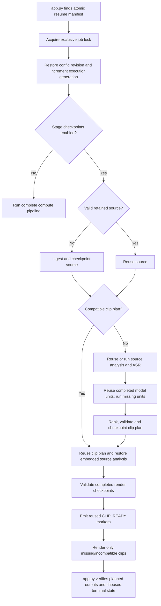

# OpenShorts Pipeline Checkpointing — Design

## Status

Implemented on the checkpointing feature branch. Static validation and focused
local smoke checks are complete; the Windows Docker interruption matrix remains
the release gate before calling the feature production-proven.

This document implements the requirements in
[Pipeline Checkpointing — Problem Statement](pipeline-checkpointing-problem-statement.md).
Exact file, function and test insertion points are listed in
[Pipeline Checkpointing — Implementation Map](pipeline-checkpointing-implementation-map.md).
The executable path and restart decisions are traced in
[Pipeline Checkpointing — Actual Code Flow](pipeline-checkpointing-code-flow.md).

## Objective

Allow an interrupted OpenShorts job to reuse each fully completed and validated
unit of work without reusing partial, corrupt, stale, or configuration-
incompatible output.

Checkpointing is a dependency graph:

- completed ASR may be reused while clip selection reruns;
- completed local-model windows may be reused while missing windows rerun;
- a completed clip plan may skip every selection step;
- completed rendered clips may be reused while missing clips rerender.

It is not a single “resume from line N” marker.

## User Configuration

Expose one setting in `.env.example` and the Windows runbook:

```dotenv
PIPELINE_CHECKPOINTS_ENABLED=true
```

Only `true` and `false`, case-insensitively and with surrounding whitespace
ignored, are valid. An invalid value must produce a clear startup/configuration
error.

| Value | Behaviour |
|---|---|
| `true` | Load compatible completed stage checkpoints and atomically save new ones. |
| `false` | Do not read or write compute-stage checkpoints. Run the complete pipeline normally. |
| Unset | Default to `false` for a backward-compatible rollout. |

Parse this setting only after `load_dotenv()` has completed and before workers
or model backends initialize. Test both direct CLI execution and jobs started by
`app.py`.

Changing the value requires only an environment change and backend
recreation/restart. It must never require a source-code rollback.

This setting controls compute-stage checkpoints. It does not disable the
existing `.resume.json` mechanism that re-enqueues an interrupted job. With
checkpointing disabled, a re-enqueued job starts its compute pipeline from the
beginning.

Disabling checkpointing does not delete existing checkpoint files. They remain
ignored until the setting is enabled again or normal job cleanup removes them.

## Existing Behaviour That Must Change First

OpenShorts already has a narrow `.transcript_checkpoint.json`, but it is not a
safe foundation for this feature:

- it identifies a source by basename and rounded duration only;
- it cannot represent a completed no-audio outcome;
- it rejects an empty/sparse transcript;
- it writes directly to the final file;
- it is a separate format from every other proposed checkpoint.

Replace it with the ASR checkpoint in this design. Do not migrate or reuse old
checkpoint content because it cannot prove source-byte identity. Legacy files
should be ignored and removed by normal cleanup.

The existing `.resume.json` also needs strengthening. It currently does not
persist every request-specific layout, hook, caption, clip-count, clip-duration,
format, provider, and model setting, and its updates are not atomic. A resumed
job could therefore run with different settings or fail to be re-enqueued after
a torn manifest write.

## Job Identity, Configuration and Ownership

Use these terms consistently:

- **job/project ID**: durable identity of one project directory;
- **configuration revision**: immutable resolved processing configuration;
- **execution generation**: one process attempt, including an automatic retry
  or restart recovery.

Automatic recovery keeps the same job and configuration revision but increments
the execution generation. A deliberate settings change creates a new
configuration revision. Persist both counters in `.job-state.json` until normal
project cleanup; do not rely on the temporary resume manifest as their only
store.

### Immutable resolved job configuration

Create an atomically written `.job-config.json` when the request is accepted.
It contains the resolved effective values used by this job, not merely the raw
request fields or current deployment defaults.

It must include at least:

- job ID, source type, and stable artifact stem;
- structured sanitized source invocation and source-cap/range choices;
- output format and aspect ratio;
- enabled layouts;
- auto-hook enabled/style/duration;
- auto-caption enabled/style defaults;
- watermark state;
- requested clip count and clip-duration band;
- requested ASR backend/model/fallback policy and resolved pre-run parameters;
- text and vision provider/model/non-secret endpoint identity, normalized
  without user-info, credentials, query strings, or fragments;
- selection, ranking, scene, and rendering implementation versions;
- creation time and job-config hash;
- credential requirements, without credential values.

Use the job ID as the stable artifact stem, or persist one immutable stem before
any output is named. A changed YouTube title must not create a second metadata
namespace. Use one stable metadata filename, such as
`<job-id>_metadata.json`.

Automatic restart recovery restores this snapshot instead of silently adopting
new deployment defaults. A deliberate user rerun with changed settings creates
a new configuration revision and invalidates only the affected checkpoints.

Persist the requested model tag and the resolved immutable model digest when
the provider exposes one. Store `null` plus an explicit
`immutable_revision_available: false` when it does not. If a tag resolves to a
different digest during automatic recovery, pause with an actionable
model-mismatch state unless the original digest can be loaded. Do not silently
continue an interrupted job using different model weights. An explicit
user-approved rerun may adopt the new digest and invalidate dependent stages.

### Credentials

Never persist API keys, access tokens, cookies, proxy credentials, or
authorization headers in job configuration or checkpoints.

Persist only which capability is required. If an interrupted job still needs a
request-scoped credential that cannot be reacquired from the managed/server
credential provider, put the job into an explicit `waiting_for_credentials`
state. The dashboard/API can resupply the credential in memory and requeue the
same job. Never silently substitute an ambient key or another user's key.

Do not persist a raw executable command in `.resume.json`. Reconstruct it from
the validated structured job configuration. Public video sources should be
represented by canonical provider/video identity. A signed/private source URL
that is no longer available must enter `waiting_for_credentials` or
`waiting_for_source` rather than being copied into plaintext state.

The existing webhook HMAC secret is operational resume state, not a compute
checkpoint. To preserve signed callback delivery across a restart, store it
only in an authenticated encrypted resume-secret record using a server-managed
encryption key. Exclude that record from archives and logs. If the encryption
key is unavailable or rotated, pause callback delivery for explicit
reacquisition; never send an unsigned callback in its place.

Use a versioned AEAD envelope for `.resume-secrets.enc`, containing only
`format_version`, `key_id`, nonce, and ciphertext. Bind the job ID,
configuration revision, and secret purpose as authenticated additional data so
ciphertext cannot be copied between jobs or purposes. Key rotation must retain
old decryption keys until their resumable jobs expire; plaintext is never
written to disk.

### Exclusive job ownership

Before starting `main.py`, `app.py` must acquire an exclusive per-job lock and
hold it for the subprocess lifetime. Use an OS-backed file lock on a fixed
`.run.lock` path and fail closed if exclusive ownership cannot be established.
This ownership rule applies to every app-managed resumable job, even when
compute-stage checkpointing is disabled, because duplicate writers can also
corrupt resume state and ordinary outputs.

Every process attempt receives a monotonically increasing execution generation
stored atomically in `.job-state.json`. Checkpoint envelopes record the writer
generation for diagnosis, but a newer generation may still reuse an older
compatible completed checkpoint.

The lease is acquired by project/job ID only; generation is not an input to
lock acquisition. After acquiring the lease, and before building the child
command or marking the job as processing, the owner atomically increments the
execution generation in `.job-state.json`. Recovery scanners only discover and
enqueue work. They never allocate a generation. This ordering prevents two app
instances from both incrementing and launching the same attempt.

Make creation, heartbeat, attempt-count, and ownership updates to
`.resume.json` atomic. A truncated resume manifest can otherwise strand valid
checkpoints because no process knows to resume the job.

Real Docker Desktop/Windows bind-mount tests must verify that the selected
locking mechanism coordinates two backend containers. If the filesystem cannot
provide reliable cross-process locking, startup must reject every app-managed
resumable job instead of permitting duplicate writers.

### Standalone CLI contract

Checkpoint-enabled standalone `main.py` runs must use a dedicated persistent
project directory:

```text
python main.py ... --project-dir <dedicated-directory>
```

The first run creates the project/job ID, `.job-config.json`,
`.job-state.json`, and lock inside that directory. A restart uses the same
directory and configuration revision. `main.py` acquires the same exclusive
lock itself in CLI mode.

When `PIPELINE_CHECKPOINTS_ENABLED=true`, reject a standalone run that omits
`--project-dir`, points it at a non-directory output, or shares a directory with
another active project. Do not place fixed checkpoint state in the current
working directory or input-file directory implicitly.

## Storage Layout

Store temporary checkpoint state inside its job directory:

```text
output/<job-id>/
├── .job-config.json
├── .job-state.json
├── .resume.json
├── .resume-secrets.enc
├── .run.lock
├── .checkpoints/
│   └── v1/
│       ├── source.json
│       ├── asr.json
│       ├── source-layout.json
│       ├── source-subtitles.json
│       ├── source-scenes.json
│       ├── text-score/
│       │   └── <64-char-compatibility-key>.json
│       ├── text-detail/
│       │   └── <64-char-compatibility-key>.json
│       ├── text-rank.json
│       ├── visual-detail/
│       │   └── <64-char-compatibility-key>.json
│       ├── cloud-visual.json
│       ├── clip-plan.json
│       └── render/
│           └── <64-char-clip-key>.json
├── <job-id>_metadata.json
└── rendered clips
```

Each stage file is independently authoritative. Do not make one frequently
rewritten checkpoint manifest the sole source of truth: a damaged central file
would invalidate all completed work and parallel render completions would
contend on it.

Checkpoint JSON stores results and hashes only. Do not duplicate source videos,
sampled frames, temporary cuts, or rendered MP4s inside `.checkpoints`.

All dynamically named checkpoint files use a lowercase 64-character SHA-256
key. Never put raw titles, transcript text, window IDs, model names, or URLs in
filenames. This avoids traversal, Windows-invalid characters, and `MAX_PATH`
pressure.

## Common Checkpoint Envelope

Every stage file uses a versioned envelope:

```json
{
  "schema_version": 1,
  "implementation_version": "asr-v1",
  "stage": "asr",
  "compatibility_key": "<64-character-sha256>",
  "status": "complete",
  "created_at": "2026-10-18T12:00:00Z",
  "writer_generation": 2,
  "source_fingerprint": {
    "sha256": "<full-file-sha256>",
    "size": 123456789,
    "duration_ms": 123456
  },
  "upstream_compatibility_keys": ["<64-character-sha256>"],
  "semantic_input_hashes": ["<hash-of-current-consumed-payload>"],
  "config_hash": "<sha256-of-resolved-effective-stage-config>",
  "payload_hash": "<sha256-of-canonical-payload>",
  "provenance_hashes": ["<historical-upstream-payload-hash>"],
  "payload": {}
}
```

Load a checkpoint only when:

- the schema and implementation versions are supported;
- `status` is exactly `complete`;
- the file is under the expected job/checkpoint directory;
- `stage`, compatibility key, source content identity, upstream compatibility
  keys, semantic input hashes, and config hash match;
- separately stored source duration is within the documented tolerance;
- the payload hash matches canonical payload bytes;
- provider-specific payload validation succeeds.

Absence or rejection means recompute that unit. A rejected checkpoint should be
logged with a reason and may be quarantined or deleted, but it must not block
the job.

Fixed-path checkpoints whose compatibility depends on an effective runtime
route use a routed load. The store first reads the envelope from its fixed
allowlisted path, validates its bounded `route` enum, and then calls a
stage-owned pure resolver to calculate the current expected key for that
recorded route. It never accepts the key stored in the file without
recalculation. This allows direct loading of `asr.json` and `clip-plan.json`
without rerunning ASR or a provider merely to rediscover the previous route.

### Source identity

Calculate SHA-256, size, and probed duration from the final playable source
artifact after source caps/range extraction have been applied. Calculate the
full source SHA once per run and reuse it.

Filename and duration are not sufficient. Use SHA-256 and size as the
`source_content_identity` included in compatibility keys. Keep duration and FPS
as separately validated source metadata. Identical SHA/size remains compatible
when probed duration differs by no more than the larger of 500 milliseconds or
two frame intervals.

### Compatibility Versus Provenance

Do not mix cache compatibility with historical model output.

`compatibility_key` answers: “May this completed result be reused under the
current source, configuration revision, and implementation?”

`payload_hash` and `provenance_hashes` answer: “What exact historical outputs
produced this result?” They provide integrity and auditability but are not
values the loader must predict by rerunning upstream models.

Compute every compatibility key as:

```text
SHA256(canonical JSON {
  stage,
  schema_version,
  implementation_version,
  source_content_identity,
  route,
  resolved_stage_config,
  expected_upstream_compatibility_keys,
  semantic_input_hashes
})
```

The `route` is either a bounded validated enum or a bounded object whose values
are validated enums. A clip plan records selection route, effective ASR route,
and ASR outcome, for example:

```json
{
  "selection_route": "speech-local",
  "asr_effective_route": "parakeet-to-whisper-cpu",
  "asr_outcome": "speech"
}
```

For a fixed-path checkpoint such as `clip-plan.json`, first read the envelope,
validate every route field, and then recompute the expected compatibility key
for that route context. Model-produced runtime outputs remain historical
provenance for the final reusable clip plan. For intermediate stages, however,
any upstream payload actually consumed by that stage is a semantic input and
its canonical payload hash must appear in `semantic_input_hashes`.

Before loading a downstream checkpoint, compute its current compatibility key
from:

- the immutable job-config snapshot;
- current supported implementation/schema versions;
- current source fingerprint;
- the compatibility keys of required upstream stages;
- the canonical payload hashes of current semantic inputs for intermediate
  stages;
- every resolved effective setting that affects the stage.

Intermediate-stage examples:

- text score/detail includes the current transcript/window payload hashes;
- global rank includes the exact current candidate payload hashes;
- local visual includes current source-scene and encoded-frame hashes;
- render includes current clip-plan, layout, subtitle-analysis, and clip
  metadata payload hashes.

`clip-plan.json` is the explicit direct-loading exception. Its compatibility key
uses the transitive **compatibility** keys for source, ASR/route, relevant
scenes, provider/model policy, prompts and schemas, windowing, scoring
reconciliation, shortlist, floor recovery, ranking, word snapping,
deduplication, normalization, and clip count/duration settings, but it does not
require the loader to reproduce the nondeterministic intermediate payload
hashes before reuse.

Its `provenance_hashes` separately record the actual transcript, score, detail,
visual, candidate, and rank payload hashes that created it. A loader can
therefore validate current compatibility without predicting nondeterministic
model output.

Canonical JSON hashing must use UTF-8, Unicode NFC normalization, recursively
sorted object keys, compact separators, finite numbers only, and a documented
stable float representation. Reject NaN and infinity rather than hashing
platform-specific encodings.

## Crash-Safe Writes

Use one shared atomic JSON writer for `.job-config.json`, `.job-state.json`,
`.resume.json`, metadata, and checkpoint envelopes. Use the same
write/replace/fsync contract for the authenticated encrypted
`.resume-secrets.enc` record:

1. Validate the completed payload in memory.
2. Create `.<name>.<uuid>.tmp` exclusively in the same directory.
3. Write canonical JSON.
4. Flush and `fsync` the temporary file.
5. Atomically replace the final path with `os.replace`.
6. Best-effort `fsync` the parent directory where supported.
7. Remove any leftover temporary file.

Retry transient sharing/permission failures a small bounded number of times.
If checkpoint persistence still fails, log it and continue without publishing
that checkpoint. Failure to save an optimisation must not fail an otherwise
successful video job. Failure to save `.job-config.json`, `.job-state.json`,
`.resume.json`, or required encrypted resume secrets is different: reject or
pause the job because safe recovery is impossible.

Resolve final and temporary paths and reject symlink escapes outside the
expected job directory.

`os.replace` plus file `fsync` prevents torn JSON. On hosts where directory
`fsync` is unsupported, including some Windows bind-mount configurations, the
guarantee across sudden power loss is weaker and must be documented. Process
kill/restart behavior must still be tested.

Atomic replacement does not prevent two valid writers racing; the exclusive
job lock is required as well.

## Checkpointed Work Units

### 1. Source ingest

`source.json` is published after a local upload/hardlink or URL download has
produced the final post-cap playable source.

The source artifact must be owned by the job for its full resumable lifetime.
For browser uploads and thumbnail-session inputs currently stored under the
shared uploads directory, move, hardlink, or copy the accepted source into the
job directory before publishing `source.json`. Job cleanup then has one owner
for both the source and checkpoints.

It records:

- source type and non-secret source identity;
- retained relative filename and stable artifact stem;
- source fingerprint;
- media probe summary;
- cap/range/download-format decisions.

For URL resume, inspect `source.json` before invoking yt-dlp. Reuse the retained
file only if it remains inside the job directory, exists, matches its hash and
size, passes `ffprobe`, and matches the original source/cap configuration.

Download into a temporary filename, validate it, and atomically publish the
source. Never delete a valid retained source before attempting another
download.

For URLs, persist a canonical provider/video identity plus a hash of the
original input URL. Do not place signed query parameters, cookies, or embedded
credentials in the checkpoint payload.

Early-audio ASR may run as an optimization, but it must not publish an ASR
checkpoint until the final video source and cap/range decision are known and
the audio is proven to belong to that final source identity.

### 2. ASR result

`asr.json` is written after the configured ASR stage—Parakeet, Whisper, or an
effective fallback—has fully completed and OpenShorts has classified it.

`transcribe_backends.py`, which owns the actual Parakeet-to-Whisper and
GPU-to-CPU fallback decisions, must return structured provenance together with
the transcript. `main.py` must not infer the effective backend from logs or
requested settings.

Valid completed outcomes are:

```json
{
  "outcome": "speech",
  "transcript": {
    "language": "en",
    "segments": [
      {"start": 0.0, "end": 1.2, "text": "Example speech", "words": []}
    ]
  }
}
```

```json
{"outcome": "no_audio", "transcript": null}
```

```json
{
  "outcome": "sparse_speech",
  "transcript": {"language": "en", "segments": []},
  "word_count": 3
}
```

For `speech`, transcript segments and timestamps must validate. For `no_audio`,
the backend must conclusively report the no-audio condition. For
`sparse_speech`, transcription must finish before the configured sparse-speech
thresholds are applied.

A user-supplied `--transcript` becomes checkpointable only when its complete
bytes validate and its SHA-256 is sealed into the job's source configuration.
If that retained transcript is missing or changes, recovery pauses or falls
back according to the current invocation instead of reusing the old output.

This stage fixes the current repeated work for no-audio, empty, and sparse
results.

### 3. Source analysis

Checkpoint independently:

- `source-layout.json`: validated Gemini/local layout choice and applied layout
  configuration;
- `source-subtitles.json`: completed burned-in subtitle detection, including a
  valid “none detected” outcome;
- `source-scenes.json`: source-level scene boundaries used by local visual
  selection.

Source scenes are different from scene detection performed on each cut clip
during reframing.

Record the effective detector/provider after fallback, not merely the requested
one. A failed detector that silently falls back to another engine produces a
different configuration identity.

Per-clip screen classification, face/person tracking, scene analysis, hook
grounding, hook burn, and caption burn remain inside the all-or-nothing render
unit in the first implementation.

### 4. Transcript scoring

Save one checkpoint per validated window score under `text-score/`, even when
several windows were returned by one model request.

This unit must record whether the score came from:

- a valid model result;
- deterministic reconciliation/fallback after a completed response omitted the
  window.

An interrupted, timed-out, blocked, or wholly malformed request produces no new
score checkpoints. Independently valid items from a partially usable completed
response may be saved after validation.

Per-window storage avoids coupling reuse to the exact batching or recursive
split path used in the prior run.

### 5. Transcript detail

For the local Qwen path, save one completed one-window result under
`text-detail/`.

Both are valid outcomes:

- one validated candidate;
- a schema-valid explicit `null`/empty candidate.

An explicit empty result is stored as `{"outcome": "empty"}` so an
uninteresting window is not repeatedly called after every restart.

Invalid JSON, transport errors, schema failures, out-of-window timestamps,
invalid duration, a non-null candidate rejected by validation, and interrupted
correction attempts are not explicit empty results and must not be
checkpointed.

The initial implementation guarantees fine-grained detail checkpointing for the
local one-window Qwen workflow.

Gemini's current batched detail/detail-floor implementation is a different work
unit because one response can compare several windows and recursively split
after errors. Version 1 does not checkpoint Gemini transcript-detail calls
below the final clip-plan boundary. Fine-grained Gemini reuse requires a
provider-neutral deterministic group plan or a persisted validated split plan;
it must not claim per-window or aggregate-detail reuse until that later design
is implemented.

### 6. Local global ranking

`text-rank.json` stores the validated global comparison of independently
selected local candidates.

Its key includes the exact candidate payload identities, local model digest,
rank prompt/schema, and ranking implementation version.

If ranking fails and OpenShorts deliberately completes selection using its
independent-score fallback, record that completed fallback outcome in the final
clip plan. Do not count the failed call as a successful cached model result.

### 7. Visual selection

For local Qwen-VL, save one result per visual window under `visual-detail/`.
The key includes:

- source fingerprint and window bounds;
- sampled frame timestamps;
- hashes of the actual encoded JPEG bytes;
- source-scene identity;
- resolved model digest and non-secret endpoint identity;
- frame count, encoded dimensions/quality, and context size;
- window/overlap, prompt/schema, decoder/sampler implementation versions;
- clip duration and candidate settings.

Do not store sampled JPEG files. Recreate the deterministic samples and compare
their hashes before reusing a visual-window result.

A schema-valid explicitly empty list is a completed result. A non-empty
response whose candidates are all rejected is not equivalent to explicit empty
and is not checkpointed.

For Gemini whole-video silent analysis, `cloud-visual.json` is published only
after upload processing and the complete response validate. An interrupted
upload or generation call has no checkpoint. The source video itself is never
duplicated into checkpoint storage.

### 8. Final clip plan

`clip-plan.json` is saved only after all applicable results have been collected,
globally ranked or deliberately fallen back, deduplicated, snapped to valid
boundaries, limited to the requested count, and normalized into renderer-safe
metadata.

It contains normalized `shorts`, the complete source-layout and burned-subtitle
decision snapshot used by rendering, and original cost/model statistics.
Restored cost statistics describe calls made in the original run and must not
be appended again as new usage.

A plan containing zero clips is not a completed successful selection stage.

On resume, a compatible clip plan skips ASR and editorial-model work and
restores its embedded source-layout and source-subtitle decisions before render
checkpoints are validated. The provider is not called again merely because an
independent `source-layout.json` or `source-subtitles.json` file is missing.
This freezes a valid `none` decision and a best-effort failure fallback alike,
so one completed plan cannot render differently after restart.

### 9. Completed clip render

Save one render checkpoint only after the entire delivery chain completes:

```text
precise cut
    → reframe/tracking
    → hook grounding and hook burn
    → caption burn
    → watermark copy, when enabled
    → final playable delivery file
```

The render identity is derived from normalized clip identity plus clip-plan
hash, not index alone. The payload records:

- clip identity and display index;
- final served relative filename;
- file size, SHA-256, duration, and probe summary;
- layout ranges and renderer-produced hook/caption metadata;
- render configuration and implementation hashes.

Before reuse, verify that the file remains inside the job directory, exists,
matches size/hash, passes `ffprobe`, and matches the current render key.

Attempt to publish the render checkpoint before emitting the existing
`CLIP_READY` marker. On resume, emit `CLIP_READY` only for validated reusable
render checkpoints and submit missing or incompatible clips to the renderer.
During the current live run, a fully validated file may still be marked ready
if checkpoint persistence failed, as defined under retry rules below.

Remove or quarantine incompatible stale render files before rerendering. Never
deliver an arbitrary filename merely because it exists.

## Resolved Fingerprint Requirements

Fingerprints use effective resolved values, not unprocessed environment text,
and never include credentials.

| Stage | Required fingerprint inputs |
|---|---|
| Source | Source type/identity, cap/range choice, downloader/format policy, final source SHA/size |
| ASR | Effective backend after fallback, model ID/revision, device/compute mode, VAD and batch settings, language/timestamp/transcript-normalization versions |
| Source layout | Provider/model revision, prompt/schema, source dimensions/samples, enabled layout set |
| Burned subtitles | Detector/OCR implementation, sampling, crop/threshold settings |
| Source scenes | Effective engine after fallback, weights/package revision, thresholds and implementation version |
| Text score | Transcript/window hash, endpoint identity, immutable model digest, prompt/schema, batching/reconciliation/windowing versions |
| Text detail | Window/group identities, model digest, prompt/schema, clip band and candidate validation/snap versions |
| Global rank | Exact candidate hashes, model digest, rank prompt/schema and ranking version |
| Local visual | Source/window/scenes, actual encoded-image hashes, decoder/sampler/JPEG settings, model digest, prompt/schema/context settings |
| Cloud visual | Source fingerprint, model revision, prompt/schema and clip settings |
| Clip plan | Transitive selection fingerprint, ranking/fallback, snapping, dedupe, normalization and target settings |
| Render | Source/plan/clip hashes, source analysis, format/aspect/layout/reframe settings, scene/face/person detectors, encoders, hook/caption/font/watermark asset hashes |

For Ollama, query and store the resolved model digest when available. A mutable
tag such as `qwen2.5:7b` by itself is insufficient.

Separate requested fallback policy from observed runtime provenance:

- job configuration stores the requested backend/model/fallback policy;
- each completed stage records a bounded effective route/backend enum plus the
  model/engine revision, device, and fallback actually used;
- a loader accepts that effective route only when it remains allowed by the
  immutable requested fallback policy, then includes its effective
  model/engine configuration in the stage compatibility key.

If a provider cannot expose a verifiable immutable model revision, version 1
must not reuse that provider's fine-grained/intermediate model-call checkpoints
across process restarts. A fully validated ASR outcome or final clip plan may
still be reused inside the same sealed job/configuration revision and retained
source. Do not silently treat endpoint-plus-model-name as immutable identity.

## Resume Algorithm



The loader may start with the furthest downstream checkpoint only after it has
computed that checkpoint's current transitive expected key.

Layout choice and burned-subtitle detection are render dependencies. Unless a
specific selector actually consumes them, exclude their model outputs from the
clip-plan compatibility key. Embed the exact decisions in the completed plan
payload and include that snapshot in the render compatibility key. Before a
final plan exists, their independent checkpoints may avoid repeated provider
calls; after a final plan exists, its embedded snapshot is authoritative.

## Retry and Terminal-State Rules

Current automatic retry deletes clip and metadata files. That would defeat
render checkpoints.

When checkpointing is enabled:

- retry cleanup preserves files referenced by valid render checkpoints;
- it removes only uncheckpointed temporary and incompatible stale output;
- metadata is recreated atomically from the current clip plan;
- app results use current-run `CLIP_READY` markers or validated render
  checkpoints, never filename-existence fallback;
- the run reports every planned clip that remains missing after its internal
  retry.

Attempt to publish the render checkpoint before emitting `CLIP_READY`. If the
checkpoint write fails but the completed file passes current-run validation,
emit the normal marker and record `checkpointed: false` in the in-memory job
result. The clip is deliverable during this run but will not be reusable after a
restart. `CLIP_READY` means “safe to serve now,” not “durably checkpointed.”

Before publishing a terminal `completed` or `partial` status, perform one
atomic `.job-state.json` transition that writes the terminal status, terminal
revision, terminal artifact ledger, missing indices, and complete applicable
terminal-action outbox together. There is no valid terminal state without its
outbox. A crash before this transition remains a resumable compute job; a crash
after it remains a terminal job with discoverable pending actions.

That transition validates the expected execution generation, allocates the
next terminal revision internally, and derives the full applicable action set
from validated job context. Callers cannot supply an arbitrary terminal
revision or omit an action.

For every delivered clip the artifact ledger records the relative filename,
file size, SHA-256, duration, probe summary, and clip-plan identity. This ledger
is an output-delivery record, not a compute checkpoint:

- terminal job recovery may validate and serve files from it;
- a nonterminal resumed computation may not use it to skip rendering;
- if the process dies before the terminal ledger is durable, an
  uncheckpointed clip is rendered again.

Use this initial terminal policy:

1. while retry budget remains, schedule the bounded automatic retry and
   preserve completed render checkpoints;
2. after retry exhaustion, return terminal `partial` when at least one planned
   clip succeeded;
3. return terminal `failed` when no planned clip succeeded;
4. return terminal `completed` only when every planned clip succeeded.

For `partial`, commit the existing processing reservation because useful output
was delivered, archive only validated successful clips, clear the resume
manifest after the terminal record is durable, and send a `job.partial` webhook
containing successful clips plus missing indices. `/api/status` must expose
`partial` as terminal and include the missing count. For `failed`, release the
reservation and send the existing failure event. Persist retry counts and the
terminal decision in `.job-state.json`.

### Terminal-action outbox

Persisting terminal artifacts is not sufficient to survive a crash during
billing settlement, archive, autopilot, webhook, analytics, email, or Telegram
actions. Store a terminal-action outbox in `.job-state.json` before running any
of those effects:

```json
{
  "terminal_actions": {
    "reservation": {"state": "pending", "attempts": 0, "event_id": "<stable>"},
    "archive": {"state": "pending", "attempts": 0, "event_id": "<stable>"},
    "autopilot_finalize": {"state": "pending", "attempts": 0, "event_id": "<stable>"},
    "autopilot_email": {"state": "pending", "attempts": 0, "event_id": "<stable>"},
    "autopilot_publish": {
      "state": "pending",
      "attempts": 0,
      "event_id": "<stable>",
      "items": []
    },
    "webhook": {"state": "pending", "attempts": 0, "event_id": "<stable>"},
    "alert": {"state": "pending", "attempts": 0, "event_id": "<stable>"},
    "proxy_usage": {"state": "pending", "attempts": 0, "event_id": "<stable>"},
    "clips_ready_email": {"state": "pending", "attempts": 0, "event_id": "<stable>"},
    "clip_activity": {"state": "pending", "attempts": 0, "event_id": "<stable>"}
  }
}
```

Omit or mark `not_required` for actions that do not apply. The outbox is
created by the same atomic transition that commits the terminal status and
artifact ledger, before any side effect. A terminal-action runner acquires the
same job lease, processes actions in the existing order, atomically increments
attempts, and records `done`, `permanent_failure`, or `manual_review`. Startup
recovery schedules terminal jobs with unfinished actions without rerunning
compute.

Release the GPU/concurrency semaphore and mark the compute queue item complete
after terminal state and the outbox are durable, before waiting for archive or
notification network calls. Terminal actions retain or reacquire only the
per-job lease, so a slow webhook cannot occupy a video-processing slot.

Use stable event IDs derived from job ID, terminal revision, and action name.
Reservation commit/release and archive upserts are retried because their
current implementations are idempotent. Refactor Autopilot into:

- an idempotent `autopilot_finalize` database transaction that persists and
  returns the same durable email/publish plan on replay;
- a separate non-idempotent email action;
- separate per-clip publish items.

Remove detached publishing from the terminal path. Mark each email/publish item
`dispatching` before its provider request; recovered ambiguous dispatches enter
`manual_review` rather than risking duplicate email or social posts.

Each selected clip is a nested outbox item with deterministic identity derived
from terminal event ID, clip key, profile reference, ordered platforms, and
scheduled time. Item updates are atomic compare-and-set transitions. The
parent publish action becomes `done` only when every item is done/not-required,
`manual_review` when any dispatch is ambiguous, and `permanent_failure` when
unambiguous retry budgets are exhausted.

Webhook delivery is **at least once**, not exactly once: include the stable
event ID in the payload and `X-OpenShorts-Event-ID` header so receivers can
deduplicate a duplicate caused by a crash after remote acceptance but before
the local `done` write. Never claim sender-side exactly-once HTTP delivery.

Email, Telegram, and analytics providers that lack an idempotency primitive use
an explicit bounded best-effort policy documented per action. Their failure
does not change the already durable terminal media result. The resume manifest
may be cleared once terminal state and the outbox are durable; unfinished
outbox actions remain discoverable through `.job-state.json`.

Proxy accounting must become idempotent before it is retried from the outbox.
Persist the stable terminal action event ID under a unique database constraint;
only a newly inserted proxy-usage row may increment in-memory counters or send
the paid-proxy alert. Email, Telegram, and non-idempotent analytics actions are
marked `dispatching` before the provider call. Recovery of `dispatching` moves
them to `manual_review` instead of blindly sending a possible duplicate.

The existing self-host S3 backup is terminal work. Remove its pre-validation
fire-and-forget call from `run_job()`. Run it as the `archive` outbox action
after terminal commit, passing only the validated artifact ledger and stable
metadata filename. Managed R2 archive and self-host S3 backup are two modes of
that action; neither scans the job directory broadly.

A successful `main.py` exit alone must not delete checkpoints. Keep them until
`app.py` has verified outputs and made the retry/terminal decision. The safest
initial policy is to retain checkpoints until normal job/project cleanup; the
JSON is small and contains no duplicated media.

## Metadata and Output Safety

Use one stable job metadata path. Write it through the shared atomic writer.
Embed the clip-plan compatibility key and render compatibility keys so stale
metadata is detectable.

App recovery must reject or remove:

- metadata with a different job-config or clip-plan key;
- nonterminal render files not referenced by a validated current render
  checkpoint;
- multiple legacy metadata files whose ownership is ambiguous.

Terminal recovery may also accept files referenced by the validated terminal
artifact ledger in `.job-state.json`, including a file whose compute render
checkpoint could not be persisted during the completed live run.

Existing user-facing metadata is an output artifact, not an authoritative
checkpoint. It can exist before all renders complete.

## Data Retention and Cleanup

Checkpoint files contain transcripts and model-derived content and are
temporary personal data.

They must:

- remain inside the job directory;
- use the same TTL and disk-cap ownership as the job;
- be deleted by project deletion, account erasure, job-retention cleanup, and
  size-cap eviction;
- be excluded from S3/R2 archives, clip ZIP downloads, static media serving,
  and job/gallery listings;
- never include credentials or sampled image bytes.

The encrypted `.resume-secrets.enc` record uses the same job TTL, account-
erasure, project-deletion, and size-cap cleanup. It is excluded from every
archive, download, static route, listing, and diagnostic bundle.

Update `s3_uploader.py` so dotfiles, temporary files, `.checkpoints/`, and
legacy `.transcript_checkpoint.json` are explicitly excluded. Verify all
managed archive paths separately rather than assuming top-level directory
behavior.

## Code Structure

Add provider-independent modules:

```text
checkpoint_store.py
job_state.py
```

`checkpoint_store.py` owns:

- enable/disable configuration parsing;
- canonical JSON and SHA-256 helpers;
- source/artifact verification;
- compatibility-key construction;
- routed fixed-checkpoint loading;
- shared app/main render-key validation;
- safe fixed-key paths;
- atomic checkpoint reads/writes;
- common envelope validation;
- null-store behavior when disabled.

`job_state.py` owns:

- atomic `.job-config.json`, `.job-state.json`, and `.resume.json` writes;
- immutable resolved job configuration;
- configuration-revision and execution-generation updates;
- exclusive job locking;
- encrypted resume-secret records;
- terminal artifact and terminal-action outbox transitions;
- stable artifact naming.

Modify `transcribe_backends.py` to expose structured effective ASR provenance.
It remains the owner of fallback decisions; neither `main.py` nor checkpoint
storage infers fallback identity from logs.

Move `load_dotenv()` ahead of every environment-sensitive import, or replace
import-time environment constants with explicit resolved runtime configuration
objects. This applies to existing modules such as `layout_picker`, which
currently reads settings during import. The saved configuration and
fingerprints must describe the values actually used, not later values loaded
from `.env`.

Provider modules validate their own payloads and contribute resolved
fingerprints, but must not invent independent storage formats.

Recommended shape:

```python
store = CheckpointStore(
    output_dir=output_dir,
    source=source_identity,
    job_config=job_config,
    enabled=pipeline_checkpoints_enabled(),
)

result = store.load(stage, expected_compatibility_key)
store.save_complete(stage, expected_compatibility_key, payload, provenance)
```

When disabled, return a null store with the same interface. This keeps
enablement branches out of provider and render code and guarantees that
`false` disables reads and writes consistently.

## Implementation Sequence

Use separate reviewable commits:

1. Add atomic JSON helpers, `.job-config.json`, atomic `.resume.json`, stable
   artifact naming, `.job-state.json`, encrypted resume-secret persistence,
   exclusive job ownership, and tests.
2. Add `checkpoint_store.py`, `PIPELINE_CHECKPOINTS_ENABLED`, null-store
   behavior, source fingerprinting, and Windows-safe paths.
3. Add retained source-ingest checkpointing and URL-source reuse.
4. Add structured provenance to `transcribe_backends.py` and replace the
   legacy transcript checkpoint with explicit ASR outcomes.
5. Add source layout, burned-subtitle, and source-scene checkpoints.
6. Add local transcript score, one-window detail, and global-rank checkpoints.
   Gemini batched transcript detail remains explicitly outside version 1
   fine-grained checkpointing.
7. Add local visual-window checkpoints and validated cloud-visual completion
   where an immutable provider model revision is available.
8. Add the transitive final clip-plan checkpoint and atomic metadata.
9. Add per-clip render checkpoints, marker restoration, and retry preservation.
10. Add terminal artifact recovery and the durable terminal-action outbox.
11. Update cleanup/archive behavior, `.env.example`, Windows runbook, and
    restart/kill end-to-end tests.

Do not begin provider or render checkpointing before commits 1–3 establish
stable job identity, configuration, source reuse, and exclusive ownership.

## Required Tests

### Configuration and storage

- unset defaults to disabled;
- `true` enables and `false` disables all compute checkpoint reads/writes;
- invalid values fail clearly;
- direct CLI and `app.py` child jobs read configuration after dotenv;
- partial temp files, corrupt JSON, wrong compatibility keys, hashes, schemas,
  and implementation versions are ignored;
- checkpoint-save failure does not fail the video job;
- manifest, job-config, job-state, or required resume-secret save failure
  prevents unsafe resumability.

### Identity and ownership

- same filename/duration but different bytes is rejected;
- identical bytes with small duration-probe drift is accepted;
- URL resume reuses a retained playable post-cap source without redownloading;
- early ASR cannot checkpoint before final source/cap identity;
- a changed title still produces one stable metadata namespace;
- manifest truncation cannot replace the previous valid manifest;
- two app instances cannot run the same job;
- stale takeover increments execution generation without invalidating compatible
  completed checkpoints;
- request-specific layouts, hooks, captions, clip controls, format, and
  provider/model settings survive restart;
- two checkpoint-enabled standalone CLI runs cannot share one project
  directory, and CLI restart reuses the same project identity;
- checkpoint-enabled CLI without `--project-dir` is rejected;
- unavailable request-scoped credentials produce `waiting_for_credentials`;
- lost signed/private source authorization produces `waiting_for_source`;
- encrypted resume-secret records reject a different job ID, purpose, key ID,
  or configuration revision.

### ASR and source analysis

- `speech`, `no_audio`, and `sparse_speech` resume correctly;
- effective Parakeet-to-Whisper fallback identity is recorded;
- unproven `--transcript` content is not promoted;
- layout, no-layout, burned-subtitle, no-subtitle, source-scene, and effective
  detector-fallback outcomes invalidate correctly.

### Model selection

- completed local score/detail/visual windows are reused;
- interrupted windows rerun;
- explicit empty differs from non-empty/all-invalid;
- partially valid responses save only validated units;
- recursive/batched Gemini transcript detail is explicitly not checkpointed at
  fine granularity in version 1 and is never falsely treated as per-window
  cached;
- local global ranking and deliberate ranking fallback behave consistently;
- cached and new cost statistics are combined without double counting;
- when ASR, candidate, scene, or sampled-frame payloads change under the same
  configuration compatibility key, downstream intermediate semantic-input
  hashes invalidate the affected score/detail/rank/visual units;
- changing model digest, endpoint, prompt, schema, windowing, shortlist, floor,
  rank, clip duration/count, snap, dedupe, or normalization invalidates only
  the appropriate stage and downstream work;
- unavailable immutable model identity disables reuse of the final clip plan
  as well as lower model-output checkpoints for that provider route;

### Rendering and retry

- when render checkpoint persistence succeeds, it is durable before
  `CLIP_READY`;
- when render-checkpoint persistence fails, the validated current-run clip is
  marked deliverable but non-reusable;
- a terminal artifact ledger preserves that delivered clip across a later
  backend restart without allowing it to skip a nonterminal rerender;
- terminal recovery after render-checkpoint persistence failure serves the
  artifact ledger entry only after revalidating its file hash and probe;
- checkpoint-disabled or clip-plan-save-failed current runs validate the
  planned set using generation-bound atomic metadata and an internal plan-ready
  marker, without treating it as a reusable checkpoint;
- restart emits markers for reused clips and renders only missing clips;
- auto-retry preserves completed render files;
- invalid/stale files are never delivered by filename fallback;
- changing subtitle, hook, font, watermark, output, layout, reframe, detector,
  or encoder inputs invalidates renders without rerunning ASR/selection;
- missing planned clips enter the documented retry/partial/failure policy;
- `completed`, `partial`, and `failed` settle reservations, archives, webhooks,
  manifests, API status, and retry counters according to the documented policy.
- terminal-action restart tests prove idempotent actions resume, webhook event
  IDs remain stable with at-least-once delivery, and non-idempotent
  notifications enter the documented dispatch/manual-review state;
- a crash immediately before the atomic terminal state/artifact/outbox
  transition resumes compute, while a crash immediately after it resumes
  pending actions without rerunning compute;

### Retention and Windows

- project deletion, account erasure, TTL cleanup, and size-cap eviction remove
  nested checkpoints and encrypted resume secrets;
- S3/R2/archive/ZIP/static routes never expose checkpoints;
- Docker Desktop Windows bind mounts pass atomic replace, process kill,
  `docker compose kill/down/up`, file-lock coordination, path-length, and
  backend-recreation tests.

## Acceptance Criteria

The implementation is complete only when:

1. the immutable job configuration and retained source can survive restart;
2. duplicate writers are prevented;
3. every completed unit has a computable current compatibility key;
4. partial and explicit-empty outcomes cannot be confused;
5. automatic retry preserves validated completed renders;
6. cleanup/archive paths account for nested sensitive checkpoint data;
7. `PIPELINE_CHECKPOINTS_ENABLED=false` produces pre-feature functional
   behavior and writes no compute checkpoints;
8. end-to-end interruption tests pass after every supported stage boundary on
   Linux and Docker Desktop for Windows.

The architecture is ready for implementation, which should proceed in the
ordered commits above rather than as one large change.
