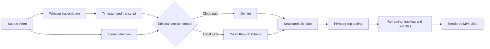

# OpenShorts Pipeline Checkpointing — Problem Statement

## Background

OpenShorts processes a source video through several compute-intensive stages:



Whisper transcription, scene analysis, LLM inference, and video rendering can each consume substantial time, CPU, GPU, and memory. A long video may take many minutes to progress through these stages.

## Problem

If processing is interrupted after a stage has completed—for example by stopping Docker, restarting the laptop, rebuilding a container, an application error, or a later pipeline stage failing—OpenShorts may repeat work that was already completed successfully.

Examples include:

- Whisper finishes transcribing a 30-minute video, but clip selection later fails.
- Several Qwen analysis requests complete, but a later request or validation step fails.
- Some clips finish rendering, but another clip causes the job to fail.
- A silent-video analysis fails after the application has already confirmed that the video contains no meaningful speech.

Repeating these completed operations wastes processing time and compute. It can also produce different LLM results when a model is called again, because model responses are not guaranteed to be identical between runs.

## Required Behaviour

OpenShorts should preserve a checkpoint only after a pipeline stage has fully completed and its output has been validated.

An incomplete stage must never be treated as completed:

```text
Stage starts
    ↓
Stage is interrupted or returns invalid output
    ↓
Do not create a checkpoint
```

```text
Stage starts
    ↓
Stage completes successfully
    ↓
Validate the complete output
    ↓
Save the completed output as a checkpoint
```

For Whisper, the completed timestamped transcript is the checkpoint. “Whisper completed” and “timestamped transcript created” are not two independent checkpoints; they form one successful stage boundary.

A valid completed Whisper outcome may be:

- A timestamped transcript containing meaningful speech.
- A completed result confirming that the video has no audio.
- A completed result confirming that the audio contains too little meaningful speech and the video must use visual analysis.

If Whisper is interrupted before reaching one of these completed outcomes, no Whisper checkpoint should be recorded.

## Expected Resume Behaviour

When the same project resumes, OpenShorts should:

1. Check whether a valid completed output exists for the next pipeline stage.
2. Confirm that the checkpoint belongs to the same source video and compatible processing configuration.
3. Reuse the checkpoint when it is valid.
4. Restart the stage normally when the checkpoint is missing, incomplete, corrupt, or incompatible.
5. Continue from the first stage that does not have a valid checkpoint.

For example:

```text
Whisper completed and transcript checkpoint exists
    ↓
Docker or OpenShorts restarts
    ↓
Transcript checkpoint is validated
    ↓
Whisper is skipped
    ↓
Processing resumes with clip analysis
```

## Desired Result

Checkpointing should prevent completed work from being unnecessarily repeated while ensuring that partial, corrupt, stale, or incompatible results are never reused.

The intended outcome is:

- Less repeated CPU and GPU work.
- Faster recovery after interruption or downstream failure.
- No reuse of partial model output.
- Consistent clip-selection results within a resumed project.
- Safe continuation from the latest fully completed pipeline stage.

## Scope of This Document

This document records only the checkpointing problem and required behaviour. It does not prescribe the storage format, implementation architecture, configuration variables, cleanup policy, or code changes.
